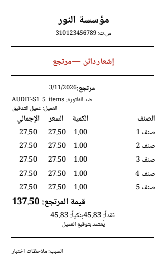
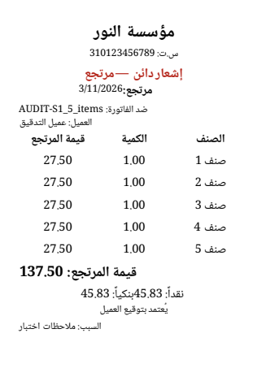

# تقرير إصلاح الطباعة F — قوالب 80mm ومسار الطابعة

**التاريخ:** 2026-11-03  
**النطاق:** قوالب 80mm، توجيه الطباعة بالاسم، تحذير توافق عرض الورق، ومصفوفة PDFium. لم تُجرَ تغييرات schema أو `build_runner` أو زيادة لحدود ratchet.

## ما تغيّر

- نُقلت قوالب 80mm الستة إلى `layoutVersion: 2` كي يستخدم مسار الطباعة الفعلي التخطيط نفسه الذي اجتاز فحص المعاينة. أُضيفت أوزان `columnsJson` متوازنة للقوالب الحرارية العامة، وأُخفيت أعمدة التسلسل غير الضرورية. مرتجعات المبيعات تستخدم جدولاً من ثلاثة أعمدة بلا عناصر الخطوط التي كانت ترسم أشرطة سوداء. عولجت ملفات [quick sale](<../../assets/invoice_templates/thermal80_quick_sale.json>) و[sales return](<../../assets/invoice_templates/thermal80_sales_return.json>) و[classic](<../../assets/invoice_templates/thermal_classic.json>) و[comprehensive](<../../assets/invoice_templates/thermal_comprehensive.json>) و[modern](<../../assets/invoice_templates/thermal_modern.json>) و[kitchen](<../../assets/invoice_templates/kitchen_professional.json>).
- يدعم استيراد القوالب الآن `tableSettings.columnsJson` باستخدام الحقل الموجود، دون تعديل schema: [DAO](<../../lib/data/database/daos/invoice_template_dao.dart>).
- أزيلت الرموز التعبيرية غير المدعومة بخط الطباعة من قوالب 80mm التي عُرضت كمربعات فارغة؛ بقي النص العربي المقابل.
- أضيف إرسال PDF مباشر للطابعة المسماة مع نقطة حقن للاختبار، وأصبح helper يعيد نتيجة Windows الأصلية بدلاً من افتراض نجاح الطباعة. محلّل الطابعة يطابق الطابعة المختارة ولا يحوّل اختياراً صريحاً غير محلول إلى طابعة النظام الافتراضية. شاشة «طباعة تجريبية» توجّه PDF إلى الطابعة المختارة، أو تفتح الحوار عند عدم تحديد هدف. الملفات: [PDF helper](<../../lib/services/printing/pdf_compute_helper.dart>)، [resolver](<../../lib/services/printer_resolver.dart>)، [template routing](<../../lib/services/templated_invoice_service/template_resolution.dart>)، [print-test screen](<../../lib/presentation/print_test_picpos/screens/print_test_picpos_screen.dart>).
- اختبار الأعمدة يقيس كل أصل 80mm، واختبار `probePrintout` يجرب الحالات الخمس لكل قالب؛ لا إخفاقات حجب، وكل عمود ظاهر بعرض لا يقل عن 12mm. اختبار التوافق يغطي 58mm و80mm على طابعة 210mm ويتحقق من نص التحذير والعرضين. الاختبارات: [thermal templates](<../../test/unit/thermal_template_columns_test.dart>)، [named dispatch](<../../test/unit/named_printer_dispatch_test.dart>)، [paper warning](<../../test/unit/paper_width_guard_test.dart>).

## صور قبل/بعد — إيصال مرتجع المبيعات 80mm

قبل: خطوط سوداء متراكبة، وجدول أضيق من حد العمود.



بعد: جدول من ثلاثة أعمدة واضح، بلا الأشرطة السوداء.



صور أخرى بعد الإصلاح: [modern](<print_fix_F_2026-11-03/thermal_modern_S1_5_items.png>)، [comprehensive](<print_fix_F_2026-11-03/thermal_comprehensive_S1_5_items.png>)، [kitchen](<print_fix_F_2026-11-03/kitchen_professional_S1_5_items.png>)، و[ورقة الاتصال](<print_fix_F_2026-11-03/new_templates_contact_sheet.png>).

## نتائج التحقق

- مصفوفة PDF كاملة عبر `RUN_PRINT_AUDIT=1` نجحت، وكتبت المخرجات إلى `D:\qa\print_fix_F\invoices`. أُعيد التصيير باستخدام [renderer](<../../tool/print_audit/render_pdfium_sheets.py>)؛ مجلد الأدلة يحوي 94 صورة منتقاة/ورقة اتصال، ومنها حالات 120 صنفاً. بقيت ملاحظة خارج نطاق 80mm: قالب [A4 الاحترافي](<../../assets/invoice_templates/a4_professional.json>) ما زال يحتوي الرمز `🌟` غير المدعوم بخط الطباعة؛ لم أعدّل A4 حفاظاً على المقارنة المطلوبة.
- مقارنة PDFium للصفحة الأولى بين D وF كانت متطابقة بكسلياً في **266/266** ملفاً من A4/A5/58mm. تغييرات النسخة النهائية بعد تلك المقارنة محصورة في قوالب 80mm، ولم تتغير أصول المقاسات الثلاثة.
- اختبارات الأعمدة وفحص التطبيق لجميع القوالب الستة وحالات البيانات الخمس نجحت. تحذير الورق اختُبر على العرضين 58mm و80mm مع طابعة A4 بعرض 210mm.
- اختبار توجيه الطابعة المحقونة يثبت وصول نفس `Printer` المختار وبايتات PDF إلى حد الطباعة، ويثبت أيضاً تمرير رفض native queue كـ`false`. فحصت تنفيذ `printing 5.14.2` على Windows: مع اسم طابعة غير فارغ يستعمل `CreateDC("WINSPOOL", ...)` ويتجاوز `PrintDlg`. **لم يُجرَ إرسال حي إلى spooler أو اختبار على جهاز فعلي**؛ لذلك لا أدّعي تحققاً مادياً من مهمة طباعة.
- مجموعة الاختبارات المطلوبة النهائية نجحت: **200 اختباراً**، بما فيها `file_size_ratchet_test.dart` والحراس الستة. أثناء العمل تغيّر ملف `invoice_template_seeder_dao.dart` المتزامن من المالك؛ أُعيد فحص ratchet على حالته الحالية ونجح. لم ألمسه ولم أرفع سقفاً.
- آخر `flutter analyze lib` لم يجد أخطاء، لكنه خرج بـ`exit code 1` مع إشعارين `use_build_context_synchronously` في `purchase_returns_picpos_logic.dart:48` و`sales_returns_picpos_logic.dart:84`. هذان الإشعاران قائمان خارج تعديلات المهمة.
- لم تتوفر قاعدة بيانات تشغيل `.db`/`.sqlite` في مساحة العمل، لذلك لا أستطيع تسمية الصفوف الثلاثة من أصل 10 التي ظهرت «تحتاج معالجة» في شاشة الحسم اعتماداً على عدّاد الصورة وحده. [خريطة أنواع المستندات](<../../lib/services/printing/template_resolver.dart>) تستثني `quotation` و`report` من المسارات الموصولة حالياً؛ تحديد المسار الثالث يحتاج صفوف شاشة الحسم من قاعدة بيانات التشغيل. لم أغيّر هذا المسار خارج المهمة.

## القوالب 80mm المتاحة

المخزون الحالي يحتوي القوالب الستة أعلاه. لم يظهر قالب شراء أو إغلاق وردية بعرض 80mm؛ المتاح لهذين الاستخدامين في الأصول هو 58mm. قالب المطبخ 80mm الموجود هو `kitchen_professional.json`.

## أوامر التحقق

```powershell
flutter test --concurrency=1 --dart-define=APP_BRAND=picpos test/unit/named_printer_dispatch_test.dart test/unit/thermal_template_columns_test.dart test/unit/paper_width_guard_test.dart test/unit/printing_layout_v2_test.dart test/structural/template_files_are_complete_test.dart test/unit/seeded_templates_map_to_bands_test.dart test/unit/printing_characterization_test.dart test/print_audit/setup_path/setup_path_audit_test.dart test/structural/file_size_ratchet_test.dart test/structural/i18n_coverage_test.dart test/structural/i18n_runtime_safety_test.dart test/structural/dark_mode_guard_test.dart test/structural/analytics_parity_test.dart test/unit/presentation_db_import_guard_test.dart
$env:RUN_PRINT_AUDIT='1'; flutter test --concurrency=1 --dart-define=APP_BRAND=picpos test/print_audit/invoices/print_matrix_test.dart
flutter analyze lib
```
